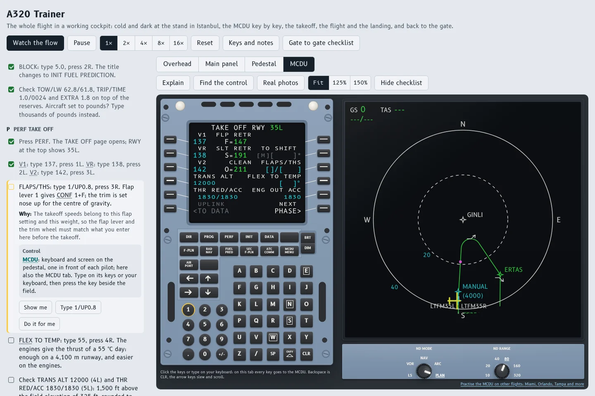

# A320 Trainer

The whole flight of an Airbus A320 in a working cockpit, in the browser: from a cold and dark stand at Istanbul Airport through the MCDU setup, the takeoff, the climb, the ILS and the landing, back to the gate and cold and dark again.

**Open it: https://onatcakici.github.io/a320trainer/**

## What it does

* A cockpit where every switch, knob, lever and screen of the flow works: the overhead panel, the glareshield and main panel, the pedestal and the MCDU, with the systems behind them and the sounds of the airplane.
* A guide beside the cockpit that names each control, says why it matters, and can fly the whole flow for you while you watch.
* New flight, which sets up each session as an instructor would: where to start, from cold and dark at the gate to 12 NM out on the ILS; the weather, from a clear day to fog with a CAT 3 autoland; a light, typical or heavy load; day or night; and how much help you get, up to a check ride with none.
* An EFB with the papers of the flight, the flight plan, the weather and the load sheet, and the takeoff performance worked out from them.
* The MCDU taught key by key, and an MCDU practice for other flights around Istanbul and South Florida.
* A gate to gate checklist to fly the same flight in a desktop simulator or a full flight simulator.

## On an iPad, a phone or a computer

It runs in any current browser. On an iPad, open the address in Safari, then Share, Add to Home Screen: it opens full screen with its own icon, and after the first visit it also works without internet. On a computer, Chrome and Edge can install it as an app from the address bar.

## Simulator use only

This project is for flight simulation and study. It is not an approved training device, course, checklist or source of flight data, and it must never be used for real flight operations, flight planning or navigation, or towards a licence or rating.

Its procedures, speeds, weights, charts and navigation data are simplified, partly made up for the trainer's flight, and out of date. Real flights follow the operator's approved manuals and checklists.

It is provided as is, without warranty of any kind, as the MIT licence says, and the author accepts no responsibility or liability for any use of it.

Airbus, A320 and A330 are trademarks of Airbus. This project is independent and not affiliated with, endorsed or sponsored by Airbus. Other product names belong to their owners.

## Credits

* Code under the MIT licence, see `LICENSE`.
* B612 and B612 Mono, the typefaces made for Airbus cockpit displays, by the B612 Project Authors under the SIL Open Font License 1.1, see `fonts/OFL.txt`.
* Inter, by the Inter Project Authors under the SIL Open Font License 1.1, see `fonts/OFL_Inter.txt`.
* The photos come from Wikimedia Commons and keep their own licences (CC BY, CC BY SA, CC0 or public domain); the author, the licence and a link to the original are with each photo in the checklist. They are not covered by the MIT licence.
* Florida data from the FAA Coded Instrument Flight Procedures, Istanbul data from the AIP Türkiye published by DHMI, both simplified and out of date.
